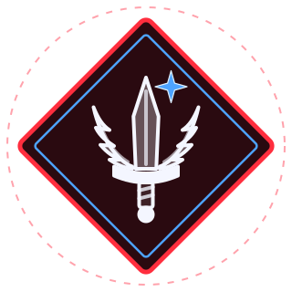

<p align="center">
  
</p>

# Flash Shiv

**A two-player card duel about staying ahead by the smallest margin.**

Every card you play has to beat your opponent's total. Play too little and you lose on the spot. Play too much and you've burned a card you'll want later. Four special cards can flip the whole fight in a single move.

Play it in your browser against the computer, or open a room and duel a friend online.

## Features

- **Two ways to play** — a computer opponent that plays fair (it never looks at your hand), or online rooms you join with a four-letter code or an invite link.
- **Dark neon fantasy look** — a glowing arcane table where every card value has its own colour.
- **Sound effects made from scratch** — thunder for Strike, chimes for Mirror, a bomb for Blast, a deep swell for Force. All generated live in the browser; there isn't a single audio file in the game.
- **Three generated music tracks** — Chill, Tense and Epic, switchable from the settings panel.
- **Move previews** — select a card and the game tells you exactly what it will do before you commit.
- **Cheat-resistant online play** — the server runs every match, so your browser never receives your opponent's hand.
- **No dependencies** — plain HTML, CSS and JavaScript, plus a small Node.js server with nothing to install.

## How to play

Each player gets 16 cards: 10 in hand and 6 in a face-down deck.

1. **Shiv.** A round opens with both players flipping the top card of their deck onto the field. Special cards count as 1 here.
2. **Attack.** Whoever has the lower total must play a card from their hand to push their total **above** the opponent's.
3. **Pressure passes back.** Now the other player is behind, and must attack in turn.
4. **Tie?** If the totals are ever equal, the field is cleared and both players shiv again.

You lose if:

- your attack leaves you **below** your opponent,
- you have **no cards** left on your turn, or
- your **last card is a special card** — that's a foul.

## The cards

| Card | In the deck | What it does |
| --- | --- | --- |
| **Shiv (1)** | 2 | Restores your reversed card. Otherwise adds 1. |
| **2 – 7** | 5, 5, 5, 4, 3, 2 | Adds its value to your total. |
| **Strike** | 4 | Reverses your opponent's last card, so it no longer counts. |
| **Mirror** | 4 | Swaps the two piles. Their lead becomes yours. |
| **Blast** | 4 | Destroys a hidden card from your opponent's hand, then you attack again. |
| **Force** | 4 | Doubles your total. A Strike can reverse it. |

The full deck has 42 cards and each game deals 32 of them, so you never know exactly what's still out there.

## Running the game

### Against the computer

Download the project and open `index.html` in a browser. That's all.

### Online

You need [Node.js](https://nodejs.org) installed. From the project folder, run:

```bash
node server/server.js
```

Open the address it prints (for example `http://localhost:3000`), choose **Create online room**, and share the code or invite link with your opponent. Players on the same network can join using the network address the server prints.

## Project layout

```
index.html          The page
css/style.css       All styling
js/cards.js         The cards and the deck
js/rules.js         The game rules (shared by the browser and the server)
js/card-art.js      The artwork on each card
js/ai.js            The computer opponent
js/ui.js            Drawing the screen
js/table.js         Card selection and move previews
js/local.js         Game flow against the computer
js/online.js        Game flow for online play
js/sound.js         Sound effects
js/music.js         Music player
js/music-*.js       The three music tracks
js/main.js          Menu and settings
server/server.js    Online server
assets/             The logo
```

## Built with

HTML, CSS, JavaScript, the Web Audio API and Node.js.
